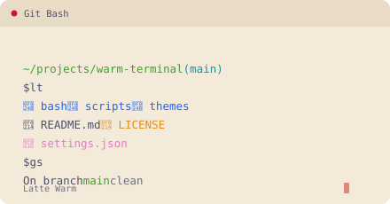
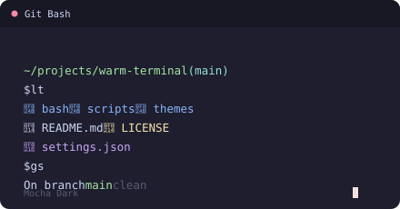
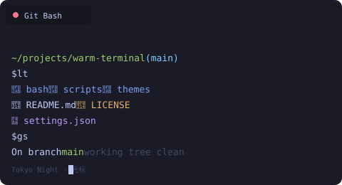
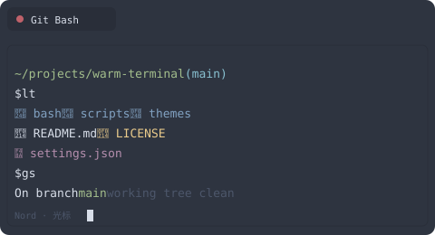
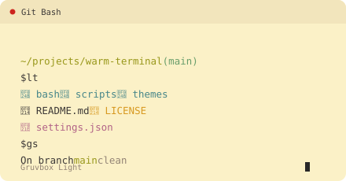
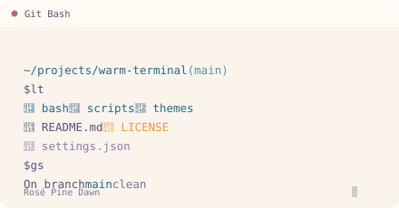
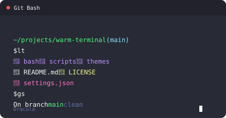
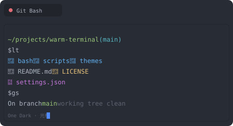

# Warm Terminal 🌤️

> 一套**带主题系统的 Windows 终端配置**：Windows Terminal + Git Bash。
> 8 套配色，一条命令切换 —— 终端配色、双行提示符、fzf、bat 同时变。

[](#)
[](#)
[](#-主题画廊)
[](LICENSE)



---

## 🎨 主题画廊

| 主题 | 风格 |
|---|---|
|  **Latte Warm** `latte-warm` | 米色暖调 · 浅色 · 默认 |
|  **Mocha Dark** `mocha-dark` | Catppuccin Mocha · 深色 |
|  **Tokyo Night** `tokyo-night` | 霓虹蓝紫 · 深色 |
|  **Nord** `nord` | 极地冷灰蓝 · 深色 |
|  **Gruvbox Light** `gruvbox-light` | 复古暖黄 · 浅色 |
|  **Rosé Pine Dawn** `rose-pine-dawn` | 玫瑰灰粉 · 浅色 |
|  **Dracula** `dracula` | 紫黑高对比 · 深色 |
|  **One Dark** `one-dark` | 经典 Atom 灰蓝 · 深色 |

> 预览图由 `scripts/gen-preview.js` 根据主题色值直接生成（SVG，不依赖截图）。

## ✨ 特性

| 能力 | 实现 | 效果 |
|---|---|---|
| 配色 | Windows Terminal 自定义 colorScheme + 标签栏 theme | 一套 JSON 管全局 |
| 字体 | `LXGWWenKaiMono NF`（霞鹜文楷等宽 + Nerd Font） | 中文等宽 + 图标 |
| 提示符 | 纯 `PS1`，双行式 | 去 `user@host`，路径 + git 分支两行 |
| 文件列表 | [eza](https://github.com/eza-community/eza) | `ls` / `ll` / `la` / `lt` 带图标 |
| 查看文件 | [bat](https://github.com/sharkdp/bat) | `cat` 语法高亮，跟随主题 |
| 跳转 | [zoxide](https://github.com/ajeetdsouza/zoxide) | `z 关键字` 秒跳 |
| 模糊搜索 | [fzf](https://github.com/junegunn/fzf) | 配色随主题联动 |
| 命令纠错 | [pay-respects](https://github.com/iffse/pay-respects) | 敲错命令后 `fuck` 自动修正 |
| Git GUI | [lazygit](https://github.com/jesseduffield/lazygit) | `lg` 打开 |
| 开窗 | 函数 `mt` | 在当前目录弹出美化终端 |

## 🏗 架构

单一数据源 + 两个生成器，主题只写一次，两边自动同步：

```
themes/<name>.json          ← 唯一数据源（配色 / 提示符色 / fzf 色 / bat 主题）
        │
        ├── gen-colors.js ──────→ ~/.warm-terminal/colors.sh   ← bash 读取（PS1、FZF_DEFAULT_OPTS、BAT_THEME）
        │                              ↑
        ├── build-wt-settings.js ─→ windows-terminal/settings.json ──→ 复制进 Windows Terminal
        │      ↑
        │   settings.base.json（profile、字体、快捷键，与主题无关的部分）
        │
        └── gen-preview.js ────→ screenshots/<name>.svg          ← README 预览图
```

- `bash/bashrc` 只认变量 `WT_DIR_COLOR` / `WT_GIT_COLOR` / `WT_BAT_THEME` / `WT_FZF_OPTS`，
  由 `apply-theme.sh` 写进 `~/.warm-terminal/colors.sh`，因此**换主题不用改 bashrc**。
- `windows-terminal/settings.json` 是**生成物**，手改会被下次切换覆盖；要改 profile / 字体请改
  `settings.base.json`。

## 📁 目录结构

```
warm-terminal/
├── bash/bashrc                       # → ~/.bashrc
├── themes/
│   ├── latte-warm.json               # 默认主题（浅色）
│   ├── mocha-dark.json  tokyo-night.json  nord.json  dracula.json
│   ├── one-dark.json  gruvbox-light.json  rose-pine-dawn.json
├── windows-terminal/
│   ├── settings.base.json            # 与主题无关的骨架（profiles / 字体 / 快捷键）
│   └── settings.json                 # 生成物：base + 当前主题
├── scripts/
│   ├── install.sh                    # 一键安装（bash 配置 + 主题）
│   ├── install-tools.ps1             # 装依赖工具（winget）
│   ├── apply-theme.sh                # 切换主题
│   ├── gen-colors.js                 # 主题 → ~/.warm-terminal/colors.sh
│   ├── build-wt-settings.js          # base + 主题 → settings.json
│   └── gen-preview.js                # 主题 → screenshots/*.svg
└── screenshots/                      # 自动生成的预览图
```

## 🚀 安装

### 1. 装字体（必须，否则图标是方块）

```powershell
scoop bucket add nerd-fonts
scoop install LXGWWenKaiMono-NF
```

或到 [LXGW WenKai](https://github.com/lxgw/LxgwWenKai) 下载安装，确认字体名带 `NF` 后缀。

### 2. 装依赖工具

```powershell
pwsh -File scripts\install-tools.ps1     # eza / zoxide / bat / fzf
scoop install lazygit
cargo install pay-respects
```

把 `eza.exe bat.exe fzf.exe zoxide.exe` 放到同一目录（默认脚本认 `D:\Tools\bin`）；
放别处就改 `~/.bashrc` 顶部的 `TOOLS_BIN`，或设同名环境变量。

### 3. 应用配置

在 Git Bash 中：

```bash
git clone <本仓库地址> ~/projects/warm-terminal
cd ~/projects/warm-terminal
bash scripts/install.sh                 # 默认主题 latte-warm
bash scripts/install.sh tokyo-night     # 或指定主题
bash scripts/install.sh --no-wt nord    # 只改 bash，不动 Windows Terminal
```

脚本行为：
1. 备份原 `~/.bashrc` → `~/.bashrc.bak-<时间戳>`，写入新配置
2. 确保 `~/.bash_profile` 里 `source ~/.bashrc`
3. 生成 `~/.warm-terminal/colors.sh`
4. 备份 Windows Terminal 的 `settings.json`，写入当前主题版本

### 4. 生效

```bash
source ~/.bashrc        # 或重开终端
```

> Windows Terminal 的配色需要**新开窗口**才生效。

## 🎛 切换主题

```bash
theme                   # 列出所有主题
theme nord              # 切换（Terminal + shell 一起换）
theme --no-wt dracula   # 只改 shell 配色
```

也可以直接跑脚本，参数完全一样：

```bash
bash scripts/apply-theme.sh tokyo-night
```

## ➕ 添加自己的主题

复制一份主题 JSON，改颜色即可，无需碰任何脚本：

```jsonc
{
  "name": "my-theme",                 // 文件名 & 命令里用的 id
  "label": "My Theme",                // Windows Terminal 里显示的名字
  "description": "一句话描述 · 深色",
  "terminal": {
    "scheme": {
      "name": "My Theme",             // 必须与 label 不同名？不用，保持唯一即可
      "black": "#000000", "red": "#ff5555", "green": "#50fa7b", "yellow": "#f1fa8c",
      "blue": "#bd93f9", "purple": "#ff79c6", "cyan": "#8be9fd", "white": "#f8f8f2",
      "brightBlack": "#6272a4", "brightRed": "#ff6e6e", "brightGreen": "#69ff94",
      "brightYellow": "#ffffa5", "brightBlue": "#d6acff", "brightPurple": "#ff92df",
      "brightCyan": "#a4ffff", "brightWhite": "#ffffff",
      "background": "#282a36", "foreground": "#f8f8f2",
      "selectionBackground": "#44475a", "cursorColor": "#f8f8f2"
    },
    "appTheme": {
      "name": "My Theme",
      "tab":    { "background": "#21222c", "unfocusedBackground": "#282a36", "showCloseButton": "hover" },
      "tabRow": { "background": "#282a36", "unfocusedBackground": "#21222c" },
      "window": { "applicationTheme": "dark" }     // 或 "light"
    }
  },
  "shell": {
    "promptDir": "\\[\\033[32m\\]",   // 路径颜色（ANSI 码，注意是 JSON 转义）
    "promptGit": "\\[\\033[36m\\]",   // git 分支颜色
    "batTheme": "Dracula",            // bat --list-themes 里的名字
    "fzf": "--height 60% --layout=reverse --border --info=inline --color=bg+:#44475a,bg:#282a36,..."
  }
}
```

```bash
node scripts/gen-preview.js            # 顺便生成预览图
bash scripts/apply-theme.sh my-theme
```

## ❓ 常见问题

**图标显示成方块？**
字体没装或名字不对。`Ctrl+,` → profile 的字体改成你装的 Nerd Font 名（带 `NF`）。

**Windows Terminal 配色没变？**
配色写在 `settings.json` 里，必须**新开窗口/标签**；已有窗口不会热重载。

**`theme` 命令找不到？**
`~/.bashrc` 里 `WARM_TERMINAL_DIR` 默认指向 `~/projects/warm-terminal`，仓库放别处就改它：

```bash
echo 'export WARM_TERMINAL_DIR=/d/code/warm-terminal' >> ~/.bashrc
```

**在 Windows Terminal 里手改的 profile 被覆盖了？**
`settings.json` 是生成物。要长期改 profile / 字体 / 快捷键，改 `windows-terminal/settings.base.json`。

**没有 Node.js 能用吗？**
可以，但只能用 `~/.bashrc` 内置的默认配色（Latte Warm），主题切换和 `settings.json` 生成会跳过。
装一个更省事：`winget install OpenJS.NodeJS.LTS`。

**换行符警告（CRLF）？**
仓库已带 `.gitattributes`；若仍有，`git config core.autocrlf false` 后重新 clone。

## ⚠️ 安全提醒

**不要**在 `C:\Users\<你的用户名>` 里 `git init` —— 会把 `.ssh`、`AppData`、`NTUSER.DAT`
一起提交上去。本仓库是独立目录，只放配置本身。

## 📄 License

[MIT](LICENSE)
